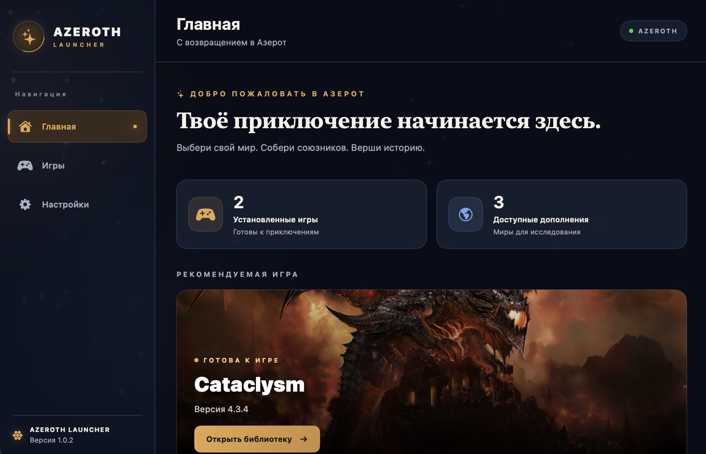
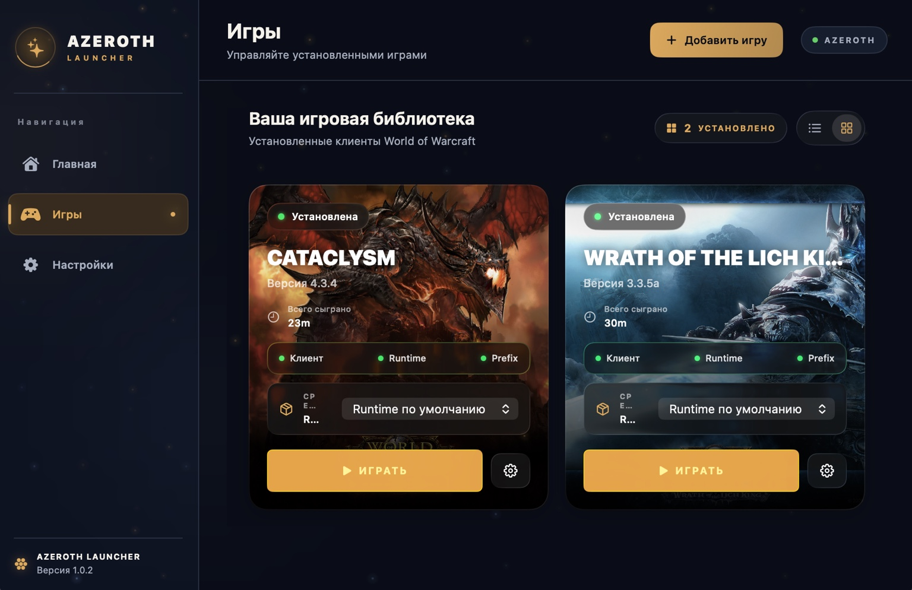
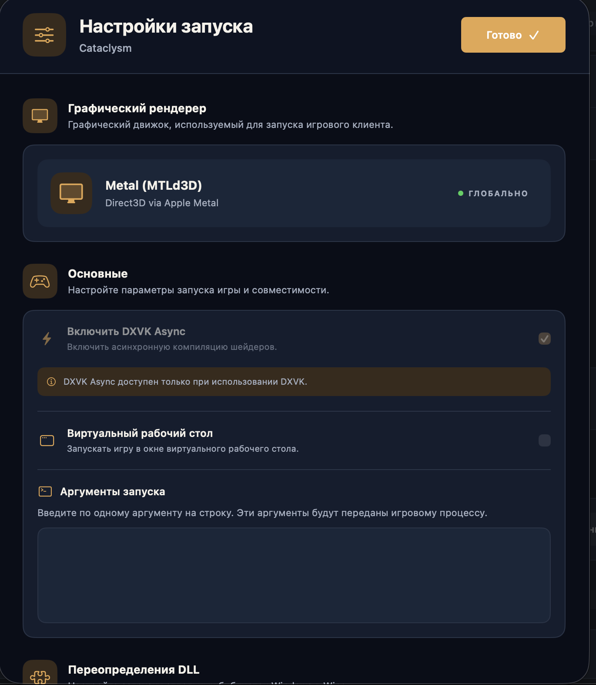
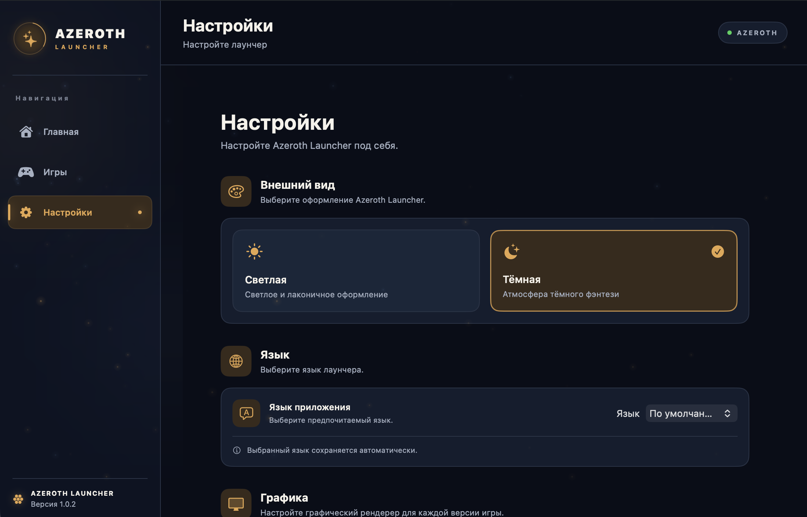

✨ Azeroth Launcher

A native macOS launcher for World of Warcraft

Manage your game installations, configure Wine environments, customize graphics, and launch your favorite World of Warcraft expansions — all from one native macOS application.

 

  <a href="#section-english">🇬🇧 English</a>
  &nbsp; · &nbsp;
  <a href="#section-russian">🇷🇺 Русский</a>

English

Overview

Azeroth Launcher is an independent native macOS application for managing and running multiple World of Warcraft game clients.

The launcher provides a centralized environment for managing different game expansions, Wine Runtime installations, graphics renderers, and individual game configurations.

Whether you play Wrath of the Lich King, Cataclysm, or Mists of Pandaria, Azeroth Launcher helps keep your game installations organized and ready to launch.

✨ Features

🎮 Game Management

* Manage multiple World of Warcraft installations.
* Support for Wrath of the Lich King.
* Support for Cataclysm.
* Support for Mists of Pandaria.
* Configure individual game installation directories.
* Validate game environments.
* Track game installation status.

🖥️ Graphics & Rendering

* DXVK renderer support.
* Metal-based rendering through MTLd3D.
* Per-installation renderer configuration.
* Graphics compatibility settings.
* DXVK Async configuration.

🍷 Wine Integration

* Wine Runtime management.
* Shared Wine Runtime across multiple game installations.
* Independent Wine Prefixes for each game.
* Wine environment configuration.
* Runtime selection for individual installations.

⚙️ Launch Configuration

* Custom launch arguments.
* Environment variables.
* DLL overrides.
* DXVK Async settings.
* Wine debugging options.
* Virtual desktop configuration.

🧰 Additional Features

* Game diagnostics.
* Realm list management.
* Addon management.
* English and Russian localization.
* Light and dark appearance modes.
* Automatic application updates powered by Sparkle.

📸 Screenshots

Home

The main dashboard provides an overview of your installed games and quick access to your game library.

Game Library

Manage multiple World of Warcraft installations from a single interface.

Launch Configuration

Configure graphics renderers, compatibility options, and individual game launch parameters.

Application Settings

Customize the application’s appearance and language.

🛠️ Technology Stack

Technology    Purpose
Swift    Application development
SwiftUI    Native macOS interface
macOS    Target platform
Wine    Windows compatibility layer
DXVK    Direct3D to Vulkan translation
MoltenVK    Vulkan implementation over Metal
MTLd3D    Direct3D rendering through Apple Metal
Apple Metal    Graphics API
Sparkle    Automatic application updates

📋 Requirements

* macOS.
* Xcode with Swift support.
* A compatible World of Warcraft game client.
* A compatible Wine Runtime.

Additional graphics compatibility requirements may depend on the selected renderer and game client.

🚀 Installation

1. Open the latest release.
2. Download the DMG or ZIP archive.
3. Install Azeroth Launcher in your Applications folder.
4. Open the application.
5. Add your existing World of Warcraft game installations.
6. Configure the required Wine Runtime and graphics renderer.
7. Launch your game.

Note: Azeroth Launcher does not distribute World of Warcraft game files. You must provide your own compatible game client.

🔨 Building from Source

Prerequisites

* macOS.
* Xcode with Swift support.
* Git.

Build Instructions

1. Clone the repository:

git clone https://github.com/IWasYourTomb/Azeroth-Launcher.git

2. Open the project:

cd Azeroth-Launcher
open "Azeroth Launcher.xcodeproj"

3. Allow Xcode to resolve Swift Package Manager dependencies.
4. Select the Azeroth Launcher scheme.
5. Choose your Mac as the build destination.
6. Build and run the application.

🔄 Updates

Azeroth Launcher integrates Sparkle for automatic application updates.

The application checks the published update feed and allows users to install new releases without manually downloading every update.

Official releases are available on the GitHub Releases page.

🗺️ Project Status

Azeroth Launcher is under active development.

The project is evolving, and its features, architecture, and compatibility may change between releases.

Public releases are available, but the project is not yet considered production-ready.

Contributions, bug reports, and suggestions are welcome.

⚖️ Disclaimer

Azeroth Launcher is an independent community project and is not affiliated with, endorsed by, or associated with Blizzard Entertainment.

World of Warcraft and all related trademarks are the property of Blizzard Entertainment.

This project does not include proprietary World of Warcraft game data or distribute the original game clients.

Users are responsible for obtaining and using game files in accordance with applicable terms and laws.

📄 License

License information will be added before the project is distributed under an open-source license.

⸻

Русский

О проекте

Azeroth Launcher — независимое нативное приложение для macOS, предназначенное для управления и запуска нескольких игровых клиентов World of Warcraft.

Лаунчер объединяет в одном интерфейсе управление игровыми дополнениями, окружениями Wine, графическими рендерерами и индивидуальными настройками запуска.

Играйте в Wrath of the Lich King, Cataclysm или Mists of Pandaria, управляйте игровыми установками и настраивайте совместимость прямо из macOS-приложения.

✨ Возможности

🎮 Управление играми

* Управление несколькими установками World of Warcraft.
* Поддержка Wrath of the Lich King.
* Поддержка Cataclysm.
* Поддержка Mists of Pandaria.
* Индивидуальная настройка директорий игровых установок.
* Проверка игровых окружений.
* Отображение состояния игровых установок.

🖥️ Графика и рендеринг

* Поддержка DXVK.
* Рендеринг через Metal с использованием MTLd3D.
* Индивидуальная настройка рендерера для каждой установки.
* Настройки графической совместимости.
* Конфигурация DXVK Async.

🍷 Интеграция с Wine

* Управление Wine Runtime.
* Использование общего Wine Runtime для нескольких игровых установок.
* Независимые Wine Prefixes для каждой игры.
* Настройка окружения Wine.
* Выбор Runtime для отдельных игровых установок.

⚙️ Настройки запуска

* Пользовательские аргументы запуска.
* Переменные окружения.
* DLL Overrides.
* Настройки DXVK Async.
* Параметры отладки Wine.
* Конфигурация виртуального рабочего стола.

🧰 Дополнительные возможности

* Диагностика игровых окружений.
* Управление списками игровых миров (Realm List).
* Управление аддонами.
* Английская и русская локализация.
* Светлая и тёмная темы оформления.
* Автоматическое обновление приложения на базе Sparkle.

📸 Скриншоты

Главная

Главный экран предоставляет обзор установленных игр и быстрый доступ к игровой библиотеке.

Игровая библиотека

Управляйте несколькими установками World of Warcraft из единого интерфейса.

Настройки запуска

Настраивайте графические рендереры, параметры совместимости и индивидуальные настройки запуска игр.

Настройки приложения

Настраивайте внешний вид приложения и предпочитаемый язык интерфейса.

🛠️ Технологический стек

Технология    Назначение
Swift    Разработка приложения
SwiftUI    Нативный интерфейс macOS
macOS    Целевая платформа
Wine    Слой совместимости с Windows
DXVK    Трансляция Direct3D в Vulkan
MoltenVK    Реализация Vulkan поверх Metal
MTLd3D    Рендеринг Direct3D через Apple Metal
Apple Metal    Графический API
Sparkle    Автоматическое обновление приложения

📋 Требования

* macOS.
* Xcode с поддержкой Swift.
* Совместимый игровой клиент World of Warcraft.
* Совместимый Wine Runtime.

Дополнительные требования к графической совместимости могут зависеть от выбранного рендерера и игрового клиента.

🚀 Установка

1. Перейдите на страницу последнего релиза.
2. Скачайте DMG или ZIP-архив.
3. Установите Azeroth Launcher в папку Applications.
4. Запустите приложение.
5. Добавьте существующие игровые установки World of Warcraft.
6. Настройте Wine Runtime и графический рендерер.
7. Запустите игру.

Важно: Azeroth Launcher не распространяет игровые файлы World of Warcraft. Пользователь должен самостоятельно предоставить совместимый игровой клиент.

🔨 Сборка из исходного кода

Необходимые инструменты

* macOS.
* Xcode с поддержкой Swift.
* Git.

Инструкция по сборке

1. Клонируйте репозиторий:

git clone https://github.com/IWasYourTomb/Azeroth-Launcher.git

2. Откройте проект:

cd Azeroth-Launcher
open "Azeroth Launcher.xcodeproj"

3. Дождитесь разрешения зависимостей через Swift Package Manager.
4. Выберите схему Azeroth Launcher.
5. Выберите свой Mac в качестве устройства сборки.
6. Выполните Build и запустите приложение.

🔄 Обновления

В Azeroth Launcher интегрирована система Sparkle для автоматического обновления приложения.

Лаунчер проверяет опубликованный канал обновлений и позволяет устанавливать новые версии без необходимости каждый раз вручную скачивать приложение.

Все официальные релизы доступны на странице GitHub Releases.

🗺️ Статус проекта

Azeroth Launcher находится в активной разработке.

Функциональность, архитектура и совместимость проекта могут меняться между релизами.

Публичные версии приложения доступны, однако проект пока не считается готовым к промышленному использованию.

Мы открыты к предложениям, сообщениям об ошибках и участию сообщества в развитии проекта.

⚖️ Отказ от ответственности

Azeroth Launcher — независимый проект сообщества, не связанный с Blizzard Entertainment и не одобренный компанией Blizzard Entertainment.

World of Warcraft и все связанные с ним товарные знаки являются собственностью Blizzard Entertainment.

Проект не содержит проприетарных игровых данных World of Warcraft и не распространяет оригинальные игровые клиенты.

Пользователи самостоятельно несут ответственность за получение и использование игровых файлов в соответствии с применимыми условиями и законодательством.

📄 Лицензия

Информация о лицензии будет добавлена до распространения проекта под открытой лицензией.

⸻

✨ Azeroth Launcher

Built for Azeroth. Made for macOS.

GitHub Repository · Latest Release · Report an Issue

